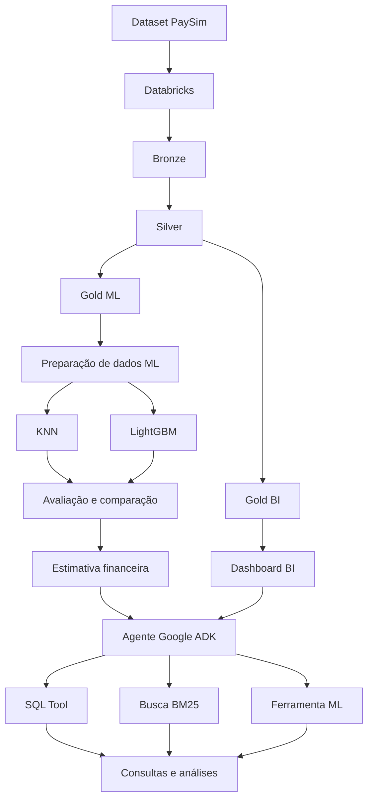

# ARQUITETURA DA SOLUÇÃO
## Grupo 5 — Cidade Inteligente: Auditoria e Prevenção de Fraudes

**Projeto:** Projeto Integrador  
**Cliente fictício:** Prefeitura de Cidade Conectada  
**Data de atualização:** 15/11/2026  
**Status:** Desenvolvimento e integração dos componentes

---

## 1. Visão geral

A arquitetura da solução Cidade Inteligente foi concebida para integrar Engenharia de Dados, Machine Learning, Business Intelligence e Inteligência Artificial em uma estrutura única de análise e auditoria de transações financeiras.

O fluxo tem início na ingestão do dataset PaySim, passa pelo processamento e organização dos dados na arquitetura Medallion e disponibiliza informações específicas para treinamento de modelos preditivos e construção de indicadores gerenciais.

Os resultados também deverão alimentar um agente de Inteligência Artificial, permitindo consultas e análises por meio de ferramentas integradas.

## 2. Arquitetura Medallion

A organização dos dados utiliza três camadas principais: Bronze, Silver e Gold.

### 2.1 Camada Bronze — Dados de origem

A camada Bronze recebe os dados originais do PaySim.

**Tabela documentada:**

`workspace.bronze.cidade_inteligente`

Responsabilidades:

- Receber os registros originais.
- Preservar as informações de origem.
- Disponibilizar os dados para processamento nas camadas seguintes.

### 2.2 Camada Silver — Dados tratados

A camada Silver representa a estrutura organizada e padronizada dos dados.

**Tabela documentada:**

`workspace.silver.transacoes`

Principais transformações:

- Padronização dos nomes das colunas.
- Tradução dos tipos de transação.
- Conversão dos tipos de dados.
- Criação de identificador de transação por hash SHA-256.
- Criação de dimensões temporais.
- Aplicação de regras de qualidade.
- Deduplicação conforme a chave definida na pipeline.

A camada Silver funciona como fonte estruturada para alimentar os componentes de Machine Learning e Business Intelligence.

### 2.3 Camada Gold — Dados especializados

A camada Gold é dividida conforme a finalidade de consumo.

#### Gold ML

**Tabela planejada/documentada:**

`workspace.gold.ml_gbm_transacoes`

Responsabilidade: disponibilizar features para treinamento e inferência dos modelos.

As características documentadas incluem:

- One-Hot Encoding dos tipos de operação.
- Valor financeiro da transação.
- Identificação de destinatários comerciais.
- Histórico de recebimentos por destinatário.
- Segmentação temporal.
- Variáveis de controle e classificação.

As variáveis de saldo foram omitidas da visão de ML para evitar vazamento de informação associado ao funcionamento do simulador.

#### Gold BI

**Tabela documentada:**

`workspace.gold.bi_fato_transacoes`

Responsabilidade: disponibilizar dados agregados para construção de dashboards e indicadores.

Entre as informações previstas estão:

- Tipo de transação.
- Tipo de conta de destino.
- Dia da simulação.
- Turno.
- Quantidade de transações.
- Volume financeiro.
- Quantidade de fraudes.
- Valor associado às transações fraudulentas.

Os indicadores percentuais deverão ser calculados a partir das métricas fundamentais, evitando distorções em agregações e filtros.

## 3. Arquitetura de Machine Learning

A frente de FinOps/ML utiliza os dados preparados para desenvolver e comparar dois algoritmos: K-Nearest Neighbors (KNN) e LightGBM.

### 3.1 Fluxo de preparação

O processo de preparação contempla:

1. Seleção das variáveis elegíveis para modelagem.
2. Investigação de Data Leakage.
3. Identificação e tratamento de outliers.
4. Tratamento de Missing Values.
5. Criação de novas features.
6. Binning de variáveis numéricas.
7. Codificação das variáveis categóricas.
8. Normalização quando necessária.
9. Separação temporal entre treinamento, validação e teste.

As transformações devem utilizar parâmetros aprendidos exclusivamente nos dados de treinamento.

### 3.2 Modelo KNN

O KNN utiliza medidas de distância para identificar transações semelhantes.

Seu pipeline considera:

- Capping de valores extremos.
- Transformação logarítmica.
- Normalização com StandardScaler.
- One-Hot Encoding.
- Estratégia de amostragem para reduzir o custo computacional.

O primeiro experimento foi treinado e avaliado utilizando uma amostra com proporção de 10 transações legítimas para cada fraudulenta.

### 3.3 Modelo LightGBM

O LightGBM será desenvolvido como segundo modelo de comparação.

A estratégia considera o aproveitamento das features disponibilizadas na Gold ML, com preparação específica para o algoritmo.

O modelo não depende de normalização das variáveis numéricas, mas deverá passar pelos mesmos critérios de separação temporal e avaliação utilizados no experimento KNN.

### 3.4 Avaliação dos modelos

Os resultados serão comparados utilizando:

- Precision.
- Recall.
- F1-score.
- PR-AUC.
- ROC-AUC.
- Matriz de confusão.
- Quantidade de falsos positivos e falsos negativos.

O conjunto de teste permanecerá reservado para a avaliação final.

## 4. Arquitetura de Business Intelligence

A frente de BI utiliza os dados agregados da Gold BI para desenvolver painéis de acompanhamento.

O objetivo é oferecer uma visão gerencial sobre o comportamento das transações e os indicadores associados às fraudes.

As análises previstas incluem:

- Volume de transações.
- Distribuição por tipo de operação.
- Quantidade de transações fraudulentas.
- Taxa de fraude.
- Volume financeiro movimentado.
- Distribuição temporal das operações.
- Estimativa de exposição financeira associada às fraudes.

Os indicadores deverão respeitar a granularidade das tabelas e as regras de cálculo documentadas.

## 5. Arquitetura de Inteligência Artificial

A frente de Engenharia de IA utiliza Google ADK para desenvolver um agente capaz de apoiar consultas e análises relacionadas ao projeto.

A arquitetura documentada prevê integração com ferramentas especializadas:

### 5.1 Ferramenta SQL

Permite consultar informações estruturadas disponibilizadas pelas tabelas do projeto.

As consultas deverão possuir controles de acesso e restrições de segurança.

### 5.2 Busca lexical BM25

Permite localizar informações relevantes em uma base de conhecimento documental.

A ferramenta será utilizada para recuperar conteúdos relacionados às regras e aos indicadores do projeto.

### 5.3 Integração com Machine Learning

O agente deverá consumir os recursos disponibilizados pela frente de ML para consultar classificações, resultados e informações das previsões.

A integração deverá ocorrer por meio de interfaces definidas entre as equipes.

## 6. Fluxo geral da solução

O fluxo arquitetural pode ser representado da seguinte forma:

O diagrama representa o fluxo lógico planejado da solução. A disponibilidade e a integração efetiva de cada componente deverão ser validadas durante a implementação.

## 7. Tecnologias utilizadas

| Componente | Tecnologias |
|---|---|
| Engenharia de Dados | Databricks, SQL, Delta Live Tables e Unity Catalog |
| Machine Learning | Python, Pandas, NumPy, Scikit-learn e LightGBM |
| Desenvolvimento | VS Code e Jupyter Notebook |
| Versionamento | Git e GitHub |
| Business Intelligence | Power BI |
| Inteligência Artificial | Google ADK |
| Busca documental | BM25 |

## 8. Integração entre as frentes

A arquitetura depende da colaboração entre os integrantes:

| Integrante | Responsabilidade |
|---|---|
| Rodrigo | Engenharia de Dados e construção das camadas |
| João Batista | FinOps, preparação e avaliação dos modelos de ML |
| Rafael | Engenharia de IA e desenvolvimento do agente |
| Raphael Aires | Business Intelligence e dashboards |
| Ramon | TechSales e proposta de valor |

Cada componente deverá disponibilizar seus dados, funcionalidades ou resultados conforme as necessidades de integração do projeto.

## 9. Segurança, qualidade e governança

A arquitetura deverá considerar:

- Controle de acesso às tabelas e recursos.
- Proteção de credenciais e informações sensíveis.
- Validação da qualidade dos dados.
- Rastreabilidade das transações por identificadores.
- Prevenção de Data Leakage.
- Separação entre variáveis preditoras e variável-alvo.
- Versionamento do código e documentação.
- Registro das decisões técnicas e dos experimentos.

## 10. Considerações sobre os dados financeiros

O projeto utiliza o dataset PaySim, composto por dados sintéticos.

Portanto, os valores associados às transações fraudulentas deverão ser apresentados como estimativas ou exposição financeira calculada sobre a simulação.

Os resultados não representam prejuízos reais, dinheiro efetivamente recuperado ou perdas comprovadamente evitadas.

## 11. Estado da implementação

A arquitetura possui componentes em diferentes estágios de desenvolvimento.

| Componente | Estado conhecido |
|---|---|
| Análise exploratória | Realizada |
| Pipeline Silver | Documentada e em desenvolvimento |
| Gold ML | Consulta de preparação documentada; materialização a confirmar |
| Gold BI | Estrutura documentada |
| KNN | Primeiro experimento concluído |
| LightGBM | Em desenvolvimento |
| Dashboard BI | Em desenvolvimento pela frente responsável |
| Agente Google ADK | Em desenvolvimento pela frente responsável |
| Integração ponta a ponta | Pendente de validação |

## 12. Conclusão

A arquitetura da solução Cidade Inteligente estabelece uma estrutura integrada para processamento de dados, desenvolvimento de modelos preditivos, visualização de indicadores e consulta por meio de Inteligência Artificial.

A separação dos componentes permite que cada frente desenvolva suas entregas de forma organizada, mantendo interfaces definidas para integração.

A evolução da solução depende da validação das pipelines, do desempenho dos modelos e da integração dos componentes em uma demonstração funcional.

---

**Documento:** Arquitetura da Solução  
**Projeto:** Cidade Inteligente — Auditoria e Prevenção de Fraudes  
**Equipe:** Grupo 5